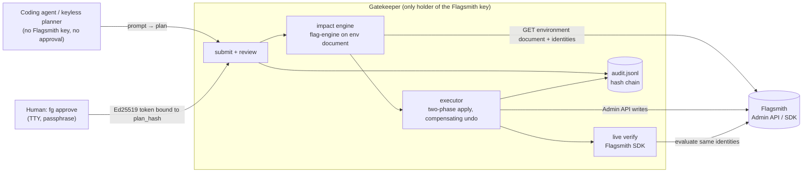

# FlagGate

*Toggle Wars, Track 2: AI Agents and Feature Flags.*

## The problem

Feature flags make rollouts safe, but setting one up by hand is many clicks in the Flagsmith UI (segment,
percentage split, override, variant weights). Letting an AI agent do it means handing it a Flagsmith Admin
key. On self-hosted open-source Flagsmith there is also no human approval gate and no audit trail you can read
(checked on v2.295.2, see [docs/SELFHOST.md](docs/SELFHOST.md)). An agent with that key can change production
flags on its own, and nobody can say afterwards what it did.

## FlagGate in one line

An agent turns a rollout or A/B request into a Flagsmith change plan with a diff and an **impact preview
computed by Flagsmith's own flag engine**; nothing is applied until a human signs the exact plan hash, and
every step is rolled back or audited through the same gate.

## 30-second demo

Real output from `demo-video/record.py readme-demo` (recorded 2026-11-26 against a throw-away organisation on
a local Flagsmith v2.295.2; 60 sampled identities). Long blocks are shortened with `[...]`. The full text is in
`demo-video/clips/readme-demo.cast`.

```text
$ fg plan "roll out new_checkout to 10% of pro users; a/b test checkout_button_color green vs orange 50/50"

plan      pl_20261126_dd49
hash      1d2d03b19163ce37efb964eed60dc8ddb1eaa38f615f309fbb6dbcfb8187ed35
rollback  48e1700e3cbfba6c08742849b00a4b749ec3babfa679d5f9e43c3ecb76a34fd8  (pre-approved together with apply)

DIFF (plan vs live Flagsmith state)
  + segments/new_checkout_rollout_pro  plan == pro AND 10% split
  ~ features/checkout_button_color/env/weights  blue 34%, green 33%, orange 33% -> blue 0%, green 50%, orange 50%
  + features/new_checkout/overrides/new_checkout_rollout_pro  {enabled: on, value: null, priority: 0}

IMPACT (Flagsmith flag engine on the environment document)
WHO CHANGES: 30 of 60 identities (50%); 30 unchanged
GUARDRAILS: max exposure 0% ≤ 100%  [OK]  (checkout_button_color)
VERDICT: APPROVABLE
[...]
$ fg apply pl_20261126_dd49
REFUSED (no_valid_approval): no approval token
$ fg approve pl_20261126_dd49
[... the human sees the diff and the impact again, recomputed locally, plus the pre-approved rollback steps ...]
Type the first 4 characters of the plan hash to approve (1d..): 1d2d
Approver passphrase:
approved by demo-human: apply token + pre-approved rollback token saved under /tmp/fgdemo-5r1j8760/home/approvals
APPLIED pl_20261126_dd49: 3 Flagsmith calls, two-phase=True, prediction matched 60/60 (audit #4)
$ fg rollback pl_20261126_dd49
ROLLED BACK pl_20261126_dd49: 8 Flagsmith calls, restored base state=True (audit #5)
$ fg audit verify
OK   chain OK, 5 records, head dbc1f10873ae; live state matches last change: True
```

Reading it: the agent's `fg apply` is **refused** because it has no signed approval. The human's `fg approve`
re-renders the plan and impact itself and asks for the first 4 characters of the plan hash and the approver
passphrase (hidden, so it is not in the output). After the apply, FlagGate evaluates the same identities
through the live Flagsmith API and reports `prediction matched 60/60`.

(In this recording the 10% pro rollout reached 0 of the 60 sampled identities. The impact preview says why:
`PERCENTAGE_SPLIT` hashes on the server-assigned segment id, which is unknown before the segment exists, so
exposure is a range, `0%–10%` here. Flagsmith's id is only known after the first phase of the apply.)

Without a Flagsmith server you can run the impact engine alone on the test fixtures:

```bash
.venv/bin/python -m flaggate.impact --plan tests/fixtures/plan_demo.json \
  --env-doc tests/fixtures/env_document_demo.json --identities tests/fixtures/identities_200.csv
# WHO CHANGES: 108 of 200 identities (54%); 92 unchanged
# GUARDRAILS: max exposure 2% ≤ 20%  [OK]  (new_checkout)
# VERDICT: APPROVABLE
```

## Quick start

Needs Linux, Python ≥ 3.11 and [uv](https://docs.astral.sh/uv/). No Docker, sudo, account or API key.
(Verified on the development box only, not on a clean machine.)

```bash
# 1. FlagGate itself (project venv in ./.venv)
uv sync --extra dev
.venv/bin/pytest -q                    # live tests skip when Flagsmith is not running
export PATH="$PWD/.venv/bin:$PATH"     # puts `fg` on the PATH

# 2. Self-hosted Flagsmith v2.295.2 on http://127.0.0.1:8600 (runtime goes outside the repo,
#    default ../flagsmith-runtime, override with FLAGSMITH_RUNTIME)
scripts/selfhost-up.sh                 # source + deps + user-space Postgres 16 + migrate + gunicorn
scripts/seed.sh                        # org/project/env, flags, multivariate flag, segment; SDK read-back
R=${FLAGSMITH_RUNTIME:-../flagsmith-runtime}

# 3. Approver key (the human, once). Asks for a passphrase twice.
fg keygen

# 4. Gatekeeper: the only process that holds the Flagsmith key
fg gatekeeper init --organisation-id 1 --project-id 1 --environment Development --from-env-file $R/local.env
fg gatekeeper start &                  # asks for the gatekeeper passphrase

# 5. Plan, approve, apply, roll back
fg plan "roll out new_checkout to 50% of pro users"
fg apply <plan_id>                     # REFUSED (no_valid_approval)
fg approve <plan_id>                   # diff + impact + rollback; type 4 hash chars + passphrase; then applies
fg audit verify && fg audit show
fg rollback <plan_id>                  # uses the rollback token that was approved together with apply
```

Other commands: `fg snapshot [--json]`, `fg show <plan_id> [--json]`, `fg plan --json "<prompt>"`,
`fg submit <plan.json> [--actor ...]`, `fg approve <plan_id> --no-apply`, `fg apply <plan_id> --token-file <f>`,
`fg audit show -n <N> [--file audit.jsonl]`.
`fg plan` uses a keyless rule-based planner. Its grammar: `roll out X to N% of <word> users`,
`a/b test X a vs b [p/q]`, enable / disable, set a value, promote, stop rollout, archive, and a trailing
`with max exposure N%`.

The impact preview needs identities. The environment seeded by `scripts/seed.sh` has some; with none the plan is
**NOT APPROVABLE** (fail-closed). Alternatively pass `--identities <absolute path>` (for example
`tests/fixtures/identities_200.csv`) to `fg gatekeeper init`.

Guardrails live in the plan: `guardrails.max_exposure_pct` and the optional
`guardrails.max_variant_shift_pct` (limit on multivariate re-assignment, off when unset); see
[docs/PLAN_SCHEMA.md](docs/PLAN_SCHEMA.md) and [docs/IMPACT.md](docs/IMPACT.md).

## Connecting an agent

*Placeholder.* The agent's side is meant to be an MCP server that only calls the gatekeeper (snapshot, submit a
plan, ask to apply). The snippet for Claude Code or Codex CLI will be added under `examples/`.
**Unverified: nothing in this repository version has been tested with a real coding agent yet.**
Until then `fg plan "<prompt>"` is the same flow with the keyless planner.

## How we use Flagsmith

| Flagsmith surface | What FlagGate does with it | Status |
|---|---|---|
| **Admin API** (`Api-Key`) | Reads the project/environment snapshot; creates features, MV options and segments; PATCHes environment feature state and segment overrides through `/api/__future__/environments/{env}/features/{f}/`; deletes overrides and segments on rollback. Only the gatekeeper holds the key. | verified on v2.295.2 (docs/CORE.md, docs/DESIGN.md §6) |
| **Environment document** (`/api/v1/environment-document/`) | The ground truth for the preview: copied, the plan's operations are applied to the copy, then both versions are evaluated. | verified |
| **flagsmith-flag-engine** 11.1.2 | `get_evaluation_result` on the "before" and "after" documents for every sampled identity: who flips, per-segment membership, exposure, variant shift, guardrails. Same path as the SDK's local evaluation. | verified (docs/IMPACT.md) |
| **Python SDK** `flagsmith==6.3.0` | After an apply, re-evaluates the same identities against the live API with `transient=True` (no new identities are created) and reports `prediction matched N/N`. Also the seed script's read-back. | verified |
| **CLI** `@flagsmith/cli` v2 | `scripts/fs-cli.sh` runs it against the local instance (`flag list`, `evaluate --identity`, writes with `--yes`). It is not on the apply path. | verified in the spike (docs/SELFHOST.md); **unverified**: the CLI evaluation step planned for the demo video |
| **MCP server** (official, stdio) | Probed with `scripts/mcp-probe.py`: 54 tools. It needs a static Admin key, so an agent holding that config could write directly. FlagGate keeps the key away from the agent instead. | probe verified; **unverified**: FlagGate's own MCP front end (dev2, not in this README's scope) |

## Architecture



## Security model

* **The agent holds no keys.** The Flagsmith Admin key is stored encrypted for the gatekeeper (scrypt + AES-GCM);
  the agent only talks to the gatekeeper over a 0600 unix socket.
* **Approvals are Ed25519 signatures** by the human's approver key, bound to the `plan_hash` (sha256 over the
  canonical plan: target, base state hash, operations, rollback operations, guardrails), single use, with an
  expiry (default 15 min). The gatekeeper stores only the public key.
* **The apply checks, in order:** token present, signature, action, plan hash, environment fingerprint, expiry,
  nonce unused, plan not already applied, **no drift** (live state hash equals the plan's base state hash), impact
  preview approvable, then a two-phase apply: new segments first, impact re-predicted with the real segment ids,
  halt and undo if a guardrail no longer holds. Every refusal is an audit record.
* **What the human sees is computed by the gatekeeper**, not taken from the agent's summary.
* **Rollback is approved together with apply** (single use, bound to the inverse plan). Promotion of a winner is
  never pre-approved.
* **Audit log:** append-only JSONL; each record carries `prev_hash` and `record_hash`. `fg audit verify` finds
  edits, removals and reordering, and checks that the live state matches the last change.

Limitations (as stated in docs/CORE.md and docs/DESIGN.md):

* `fg approve` refuses unless stdin and stdout are TTYs. A process that allocates a pty can fake that; the real
  boundary is the encrypted approver key plus the passphrase, and that the agent never holds a Flagsmith key.
  The demo recording drives `fg approve` through a pty on purpose, with a throw-away key (see docs/DEMO.md).
* A same-user agent with a keylogger or root, or a human who approves without reading, is out of scope.
  Running the gatekeeper as another user or on another host would harden it; the protocol would not change.
* The impact preview is a prediction on a sample of identities. `PERCENTAGE_SPLIT` depends on the server-assigned
  segment id, so a first estimate is a range; the two-phase apply re-predicts with the real id.
* The Flagsmith v1 operations used cannot delete a feature or a variant, or unarchive: rolling back
  `create_feature` disables and archives it, `add_variant` is set to 0%, and `archive_feature` is irreversible
  (shown on the approval screen).
* Any change to the project after planning counts as drift. You re-plan (one command).
* `local.env` from the seed script holds the Admin key in plaintext for the spike; keep it outside the repository.

## License

MIT. See [LICENSE](LICENSE). Flagsmith is a separate project with its own license; its source is not included
here (the self-host script downloads it into the runtime directory, outside this repository).
